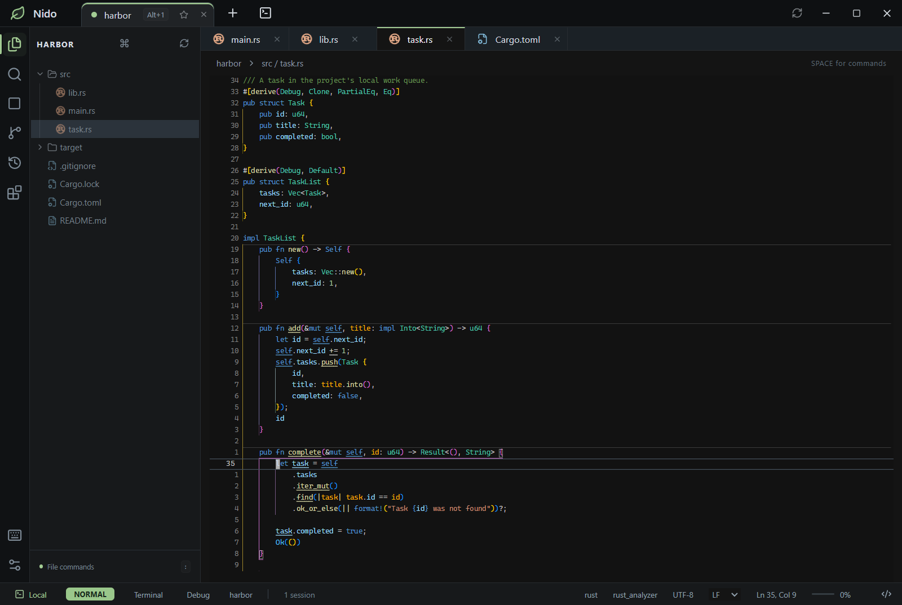

# Nido

Neovimベースの、キーボードで操作できるWindows用エディタ。
ワークスペース、ファイル検索、Git、ターミナル、Rust / TypeScriptのLSPに対応。



Rustコードの編集画面（エディターのフォントサイズ：10）。

## 開発

Windows x64・Node.js 22以降・pnpmが必要です。Neovimは初回起動時に取得します。

```powershell
pnpm install
pnpm dev
```

## 主な操作

| キー                     | 操作                 |
| ------------------------ | -------------------- |
| Ctrl+Shift+N             | ワークスペースを開く |
| Ctrl+P                   | ファイル検索         |
| Ctrl+Shift+F             | プロジェクト本文検索 |
| F2                       | シンボルのリネーム   |
| Ctrl+S                   | 保存                 |
| Ctrl+Shift+G             | Git                  |
| Ctrl+Shift+H             | 編集タイムマシン     |
| Ctrl+Shift+X             | 対応言語・機能一覧   |
| Ctrl+Shift+V（Markdown） | ライブプレビュー     |
| Ctrl+@                   | ターミナル           |
| Space（Normalモード）    | 操作メニュー         |
| Space ,（Normalモード）  | 設定                 |
| Alt+Shift+S              | Sticky Scrollに移動  |

編集はVimの操作に対応。設定からEditorConfig・相対行番号などを切り替えられます。自動整形が失敗しても編集本文は保存し、通知で知らせます。整形中に表示ファイルが変わった場合も、保存先は最初に選んだファイルに保ちます。

Markdownのプレビューはエディタの横に表示し、未保存の編集にも追従します。プレビュー内の `Ctrl+J` でエディタへ戻り、表示したまま編集できます。`Ctrl+Shift+V` で表示を切り替え、プレビュー内の `Esc` で閉じます。本文のスクロールは `j/k`・`g/G`・`Ctrl+D/U/F/B` に対応します。

ワークスペース・タブ順・選択中のファイル・カーソル位置は5秒ごとに保存し、強制終了後も直近の状態を復元します。保存データが破損した場合は、直前の正常なバックアップから復元します。通常終了時と更新前には最新状態を保存します。未保存の編集本文は、別の編集タイムマシンに保管します。

### 検索とリネーム

`Ctrl+Shift+F` またはコマンドパレットの **Search in files / ファイル内を検索** でプロジェクトの本文を検索します。入力欄の `Esc` で結果一覧へ移り、`j/k` で選択、`g/G` で先頭・末尾、Enterで該当行へ移動します。`/` で検索欄、`f` で対象フォルダー欄へ戻れます。一覧で `Esc` を押すと元のエディタへ戻ります。入力中の `j/k` は通常の文字として扱い、`Ctrl+J/K` で入力欄からも結果を選べます。

大小文字の区別は `Alt+C`、単語単位は `Alt+W`、正規表現は `Alt+R` で切り替えます。条件のボタンと入力欄は `Tab/Shift+Tab` でも移動できます。フォルダー欄には `src` などプロジェクトからの相対パスを指定し、空欄なら全体を検索します。保存済みのUTF-8ファイル（1 MiB以内）が対象で、Gitの除外設定・依存／ビルド用フォルダー・バイナリを除外し、結果は最大200行です。正規表現はJavaScript形式で各行に適用します。

一覧の `r` で置換欄を開き、置換後の文字列を入力してEnterで一覧へ戻ります。`Space` で行ごとの対象／対象外、`a` で全選択／全解除を切り替え、`Ctrl+Enter` で差分を確認します。選んだ行にある一致箇所をすべて置換し、正規表現では `$1` や `$<name>` のキャプチャ参照を使えます。通常の文字列検索では `$1` などもそのままの文字列です。

プレビューでは `j/k` でファイルを選び、Enterまたは `l` で差分へ移動します。差分の `j/k`・`Ctrl+D/U` でスクロールし、`h` でファイル一覧へ戻れます。`Ctrl+Enter` で **Apply replacement / 置換を反映** ボタンへ移り、Enterで確定します。`Esc` なら結果一覧へ戻ります。置換は未保存の編集として反映し、`:wall` ですべて保存、各ファイルの `u` で取り消せます。未保存の対象ファイルや、検索・プレビュー後に内容が変わった対象は上書きせず、保存や再検索を案内します。BOM・改行形式・末尾改行の有無を保ちます。

シンボルにカーソルを置いて `F2`（Normal / Insertモード）または `:NidoRename` で新しい名前を入力します。Enterで言語サーバーが関連する参照も変更し、Escでキャンセルします。変更は未保存の編集として扱われ、`:wall` で対象ファイルをまとめて保存できます。

### UIアニメーション

設定の **UI animations / UIのアニメーション** をONにすると、検索・コマンド入力、パレット、補完、型情報・診断、メッセージ、通知、ファイル操作、参照先プレビューの開閉を短いフェードで表示します。閉じる途中でも入力・フォーカスはすぐ戻り、設定OFFやOSの「動きを減らす」設定では即座に切り替わります。

マウスホイールの段階的なスクロールも、この設定がONのときは滑らかに補間します。タッチパッドの細かなピクセル移動は入力に直接追従します。

### 編集タイムマシン

`Ctrl+Shift+H` またはNormalモードの `Space h` で、現在のファイルの編集履歴を開きます。変更があるファイルを2秒ごとにローカルへ記録し、未保存の下書きも強制終了後に取り戻せます。直近の記録以降の編集は含まれません。

`j` / `k` で時点を選ぶと、現在の編集との違いを左右に表示します。Enterで差分へ移動、`n` / `N` で変更箇所を巡回、`Ctrl+Enter` でその時点の本文をエディタに戻します。戻す前の編集も保管し、Vimの `u` で取り消せます。ファイルへの書き込みは通常どおり `Ctrl+S` で行います。

設定の **Automatic edit history / 編集履歴を自動で残す** で記録を停止できます。停止中も、手動で履歴を開いたときと復元前には現在の編集を保管します。履歴はユーザーデータ内の `time-machine` フォルダーに保存されます。名前付きのテキストファイル（1 MiB・20,000行以内）が対象で、無題・ターミナル・バイナリは対象外です。最大20時点／ファイルかつ8 MiB／ファイル、全体で64 MiB・200ファイルまで保管し、上限を超えた古い履歴から削除します。Neovimのswap確認に依存せず、この履歴から復旧します。

左の拡張機能ボタン、`Ctrl+Shift+X`、コマンドパレットの **Extensions / 拡張機能** から、**Languages / 言語** と **Other extensions / その他の拡張** を確認できます。Rust・TypeScript/JavaScriptは言語タブ、Denoはその他の拡張タブに表示され、検索・追加・有効化・無効化できます。ワークスペースを開く前でも利用でき、Escで編集画面に戻れます。エクスプローラーのフォルダー開閉・選択・スクロール位置はプロジェクトごとに保存され、次の起動時にも復元されます。

設定の **Language / 言語** で **English / 日本語** を選べます。UIはその場で切り替わり、再起動後も選択を維持します。初期値は英語です。メニュー・コマンド検索・操作ガイド・確認ダイアログも選択した言語で表示します。

文字の太さは設定の **Editor font weight / エディターの文字の太さ** で調整できます。初期値はやや細めの350、通常の太さは400です。フォントによって対応する太さは異なります。変更は本文とSticky Scrollにすぐ反映され、再起動後も保存されます。

Sticky Scrollは、現在の関数やクラスの見出しをエディタ上端に固定します。
クリックで見出しへ移動し、Shiftを押しながら重ねると終了行を表示・クリックできます。
`Alt+Shift+S`で見出しへフォーカスし、`j` / `k`とEnterで移動、Escで編集に戻れます。
設定の **Sticky Scroll** で有効・無効と最大表示行数（初期値5）を保存できます。

設定の **Theme** で **Dark Modern / Dark Modern (Acrylic)** を選べます。選択は保存され、編集中でも切り替えられます。
Dark Modern (Acrylic)はDark Modernの配色を保った半透明のパネルを使い、Windows 11 22H2以降ではネイティブのアクリル背景も適用します。
コード領域も背景が半透明になり、文字と選択範囲は濃さを保ちます。Dark Modernでは従来の不透明な描画を使います。

Rustの`main`・テスト・テストモジュールを実行・デバッグできます。CodeLensの追加行は表示しません。
対象のコード内にカーソルを置き、Normalモードで`gR`（実行）／`gD`（デバッグ）。
操作メニューからも検索できます。ファイルを保存してから実行してください。
結果は下部パネル、ブレークポイントは`F9`、停止は`Shift+F5`です。

## 言語サポート

**Extensions / 拡張機能**（`Ctrl+Shift+X`）の **Languages / 言語** から、言語パックの追加・有効化・無効化・再読み込みができます。Rust・TypeScript/JavaScript・Denoは公式パックとして同梱され、設定は再起動後も維持されます。追加パックの形式とWSLでの動作は [言語パックの説明](docs/language-packs.md) を参照してください。

- Rust：`rustup component add rust-analyzer rust-src rustfmt`
- TypeScript / JavaScript：プロジェクトのTypeScriptを優先し、なければ外部または同梱サーバーを使用。
- Deno：インストール済みの`deno lsp`を使用。`deno.json`・`deno.jsonc`・`deno.lock`を自動検出し、補完・診断・定義・参照・リネーム・整形・コードアクション・単語ハイライトに対応。Denoの型定義やキャッシュ済み依存も読み取り専用で開けます。
- Denoが未導入の場合：`winget install --id DenoLand.Deno -e`を実行後、ワークスペースを開き直してください。設定ファイルのないDenoプロジェクトには`deno.json`（`{}`でも可）を追加してください。
- Git操作にはPATH上のGitが必要です。

## WSLに接続

左下の **Local / ローカル**、`Ctrl+Shift+N`、またはコマンドパレットの **Connect to WSL / WSLに接続** からフォルダー選択を開きます。**Connection / 接続先** で `WSL: FedoraLinux-44` などを選び、Linux側のフォルダーを選択して `Ctrl+Enter` で開きます。パス欄には `/home/ユーザー名/project` のようなLinuxの絶対パスを入力できます。`\\wsl.localhost\ディストリビューション名\home\…` と `\\wsl$\…` の直接指定にも対応します。

WSLのワークスペースではLinux版Neovim・ターミナル・言語サーバー・Gitを使用します。Windows側のワークスペースと別のタブで併用でき、接続先は左下の **WSL: ディストリビューション名** で確認できます。ファイルの編集・保存・検索・作成・移動、お気に入り、再起動後のタブ復元、編集タイムマシンも利用できます。大文字・小文字が異なるLinuxファイルは個別に扱います。

WSLとディストリビューションは事前にインストールしてください（[Microsoft公式手順](https://learn.microsoft.com/en-us/windows/wsl/install)）。初回接続時、WSL側に対応するNeovimやNode.jsがなければ、公式アーカイブのSHA256を検証して `~/.cache/nido/runtime`（`XDG_CACHE_HOME` 指定時はその配下）に用意します。初回のダウンロードにはインターネット接続と `curl`・`tar`・`sha256sum` が必要です。管理者権限やシェル設定の変更は不要です。TypeScript / JavaScriptの補完・診断は同梱サーバーをLinux版Node.jsで実行します。

Rust・Deno・Gitなどの開発ツールは、接続したディストリビューションにも導入してください。WSLでファイルを削除するとLinuxのゴミ箱へ移動します（`gio` が必要）。WSLのターミナルは、このPCで選んだWindowsシェル設定にかかわらず接続先のLinuxシェルを使います。Rustデバッグ用の同梱CodeLLDBはWindows専用です。

実際のWSLでの確認は、インストール済みの名前を指定して実行できます。テストは専用の一時フォルダーを使います。

```powershell
$env:NIDO_TEST_WSL_DISTRO = 'FedoraLinux-44'
pnpm test:wsl
pnpm exec playwright test tests/wsl.spec.ts
```

## ビルド・テスト

```powershell
pnpm build:win  # Windowsインストーラー
pnpm typecheck # TypeScript型チェック
pnpm lint      # ソースの静的解析
pnpm test      # Neovim連携・スクロール状態
pnpm test:deno # 実際のDeno LSPとTypeScriptとの切り替え
pnpm test:e2e  # ビルド済みアプリの操作
pnpm exec playwright install chromium # レンダラーのテスト用ブラウザーを初回に準備
pnpm test:renderer # ChromiumでUIの状態遷移と非同期処理を検証（Electron/Neovim不要）
pnpm test:prefetch # 先読みの画面保持を5回反復検証
```

型チェックはTypeScript 7を使います。Lintが利用するTypeScript APIは、公式の互換パッケージでTypeScript 6を併用しています。

CIは通常のレンダラーテストに加え、専用ChromiumをSwiftShaderで起動し、物理GPUがない環境でも文字の明るさ補正とGPU画像キャッシュを検証します。この専用ステップでWebGL描画を使えなければテストは失敗します。GPUが使えない場合・失われた場合の代替描画も検証します。ソフトウェアGPUの指定は専用テストのブラウザーに適用し、通常のCanvas2Dの画素比較と製品側の描画設定は維持します。

手元でCIのWebGL検証を再現する場合は、次を実行します。通常の `pnpm test:renderer` はブラウザーの標準描画環境で実行します。

```powershell
$rendererPreviousGPU = $env:NIDO_TEST_SOFTWARE_GPU
try {
    $env:NIDO_TEST_SOFTWARE_GPU = '1'
    pnpm test:renderer --grep 'slow touchpad scrolling|fractional text preserves|stationary editor|WebGL is'
} finally {
    $env:NIDO_TEST_SOFTWARE_GPU = $rendererPreviousGPU
}
```

### Windows版の基本動作確認

Windows x64で次を実行すると、警告ゼロのLint・型チェック・配布用ビルド・単体テスト・レンダラーのテスト・実アプリの操作テストをまとめて確認できます。GitとRustのMSVCツールチェーン（C++ Build Toolsを含む）、`rust-analyzer`・`rust-src`・`rustfmt`が必要です。

```powershell
rustup component add rust-analyzer rust-src rustfmt
pnpm verify:windows
```

操作テスト36件は`dist/win-unpacked/nido.exe`を直接起動します。起動と同梱リソース、日本語・空白を含むパス、CRLFでの保存、貼り付けの入力順序、Windowsクリップボード、AltGrキーイベント、IMEの変換イベント、ワークスペースとファイル操作、Git、補完・診断・参照、ターミナル、Rustデバッグ、設定と終了・復元、強制終了後のワークスペース・カーソル復元、未保存編集のタイムマシン復旧・Undo・記録停止、100%・125%・150%表示を確認します。各テストには一時フォルダーと独立したプロファイルを使います。

ビルド済みの場合は`pnpm test:windows`だけでも実行できます。必須ケースの欠落・スキップ・未処理のレンダラー例外も失敗扱いです。Windows以外では成功扱いにせず、実行条件のエラーを返します。

PRとmainへのpushでGitHub Actionsの **Windows baseline** が実行され、インストーラーのファイル転送と更新処理まで検証します。成功したCIは、検証済みのインストーラー・`.blockmap`・`latest.yml`を`windows-release-assets`として7日間保存します。失敗時はActionsの`windows-baseline-reports`からレポートとログを取得できます。このセットは主要機能の回帰確認用で、実際のIME・キーボード配列やインストーラーによる更新は別途確認してください。

## アプリの更新

最初は `nido-0.2.6-setup.exe` でインストールしてください。タイトルバーの最小化ボタン左にある更新ボタンから、更新確認・ダウンロード・再起動を行えます。
起動後にも更新を確認します。ダウンロードや再起動はボタンを押すまで行いません。再起動前に未保存ファイルを確認し、ワークスペースを保存してNeovimを終了します。
開発版や `win-unpacked` の直接起動では更新を無効にしています。失敗時は既存の通知で理由を表示し、再試行できます。

更新元は公開リポジトリ `kanata9819/Nido` のGitHub Releasesです。
`package.json` のバージョンを上げてmainへpushし、そのコミットの **Windows baseline** が成功してから、`v0.2.6` のようなタグをpushします。リリースは同じコミットの成功したCIから検証済みファイルを取得し、再ビルド・再テストせずに公開します。別コミットの成功結果は使いません。成果物の保存期間を過ぎた場合は、そのコミットの **Windows baseline** を再実行してください。
タグとバージョンが一致しなければ公開しません。インストーラー、`.blockmap`、`latest.yml` を同じReleaseへ配布し、Neovimや言語サーバーなどの同梱リソースもまとめて更新します。
ローカルの `pnpm build:win` は公開せず、インストーラーと更新情報を生成します。

Windowsのインストールでは、一時フォルダへの展開後、同じドライブならフォルダごと移動して二重のコピーを省きます。
別ドライブへのインストールや空でないインストール先では、コピーに切り替えます。
`pnpm test:installer` は隔離フォルダで移動・コピー・使用中ファイル・展開失敗を確認します。実際のインストール先やユーザー設定は変更しません。
展開後のフックは `patches/app-builder-lib@26.15.3.patch` で追加しています。electron-builderを更新する際も、このテストで移動処理が使われることを確認してください。

配布前の検証は `tests/update.spec.ts` にあります。ローカルHTTPサーバーから実際のインストーラーを取得し、ハッシュ検証・保存確認のキャンセル・保存後のインストーラー呼び出しを確認します。OSへのインストール実行はテストで置き換えています。通常CIとリリースCIでこの検証を必須にしています。
ビルド済みアプリから `dist/auto-update` に隔離したWindows版を作成し、検証を実行できます。

```powershell
pnpm build
pnpm verify:update
# フィクスチャが作成済みの場合は pnpm test:update だけで再実行できます。
```

## コードの責務

- `App.tsx`：画面全体の構成とフォーカスの連携。ワークスペース操作は `useWorkspaceActions.ts`、下部パネルの開閉・フォーカス要求は `useBottomPanels.ts`、参照・デバッガの配置は `WorkspacePanels.tsx`。設定のセッション反映は `useSessionSettings.ts`。`WorkspaceEditor.tsx` はワークスペース単位の表示をまとめ、カーソル通知によるエディタ全体の再レンダーを抑えます。
- `Sidebar.tsx`：ツリー表示とリサイズ。ファイル一覧・展開・ファイル操作は `useExplorer.ts`、移動キーは `sidebarKeyboard.ts`。
- `Editor.tsx`：入力とエディタ領域。`useEditorRendering.ts` は描画フレームとイベント購読の連携、`editorScroll.ts` はスクロール送信・描画待ち・先読み、`editorCursor.ts` はカーソル移動と点滅、`editorMotion.ts` はスクロール・行削除のフレーム合成を担当します。
- `grid.ts`：Neovimの描画命令をセル・色・行の位置へ反映。`gridCanvas.ts` はCanvas描画・行画像のキャッシュ・カーソルの部分再描画、`gridRowLayout.ts` はCodeLens行の高さ判定を担当します。`keyboard.ts` はキーイベントからNeovim入力への変換を担当します。
- `assets/*.module.css`：部品ごとのスタイル。`Nido.module.css` は画面の骨格・タブ・サイドバー、`Palette.module.css` はコマンド・フォルダー・ファイル操作のダイアログ、ほかは対応する表示部品が所有します。
- `NeovimUI.tsx`：コマンド入力・補完・メッセージ・履歴・確認待ちの表示。`ext_cmdline` / `ext_messages` を `SessionEvents` と `shared/neovimUI.ts` で受け、Nidoのカードへ反映します。編集とキー操作はNeovimが担当し、メッセージ本文は `Alt+Shift+M` でフォーカスできます。
- `GitBrowser.tsx`：Git画面の状態とデータ取得。リストは `GitBrowserList.tsx`、詳細は `GitDetails.tsx`、キー操作は `useGitBrowserKeyboard.ts`。
- `Session`：Neovimプロセスの起動・終了と公開操作の窓口。入力・保存・スクロールの順序と編集位置は `SessionInteraction`、通知と描画フレームは `SessionEvents`、ファイル操作は `SessionFiles`。ターミナル起動も同じ入力キューを使います。
- `handlers.ts`：IPCの送信元検証とエディタ操作。ワークスペースの保存・復元・終了は `workspaceHandlers.ts`、Git操作は `gitHandlers.ts`。
- `TimeMachine.tsx`：編集履歴の選択・差分・復元。`historyHandlers.ts` は記録タイマーとIPC、`HistoryService` は編集の取得・復元順序、`LocalHistory` は履歴の保存と容量制限を担当します。

## コードを読む順番

まず画面側の入口を読み、そこで呼ぶ処理をたどると、操作と結果をつなげやすくなります。
以下の画面側ファイルは `src/renderer/src/`、Neovim・IPC側は `src/main/` にあります。

- **エクスプローラのキー操作**：`Sidebar.tsx` → `sidebarKeyboard.ts`。表示中の行から選択位置を調べ、キーに応じた移動量を足し、移動先を画面内に表示します。
- **ファイルの作成・移動**：`useExplorer.ts` → `components/ExplorerCommands.tsx` → `handlers.ts` → `sessionFiles.ts`。選択から操作先を決め、ダイアログで入力を受け、メインプロセスでファイルを操作します。
- **Git画面**：`components/GitBrowser.tsx` → `GitBrowserList.tsx` / `GitDetails.tsx`。`view` は `changes`・`history`・`branches` のいずれか。取得先を調べたい場合は `gitHandlers.ts` を読みます。
- **エディタの描画**：`session.ts` → `sessionEvents.ts` → `hooks/useEditorRendering.ts`。Neovimの通知を受け、`flush` までの描画命令を一つのフレームにまとめ、画面側へ送ります。スクロール中は行と端数の位置をまとめて反映します。

描画・行配置・括弧通知の最適化と測定方法は [パフォーマンス検証](docs/performance.md) にまとめています。
