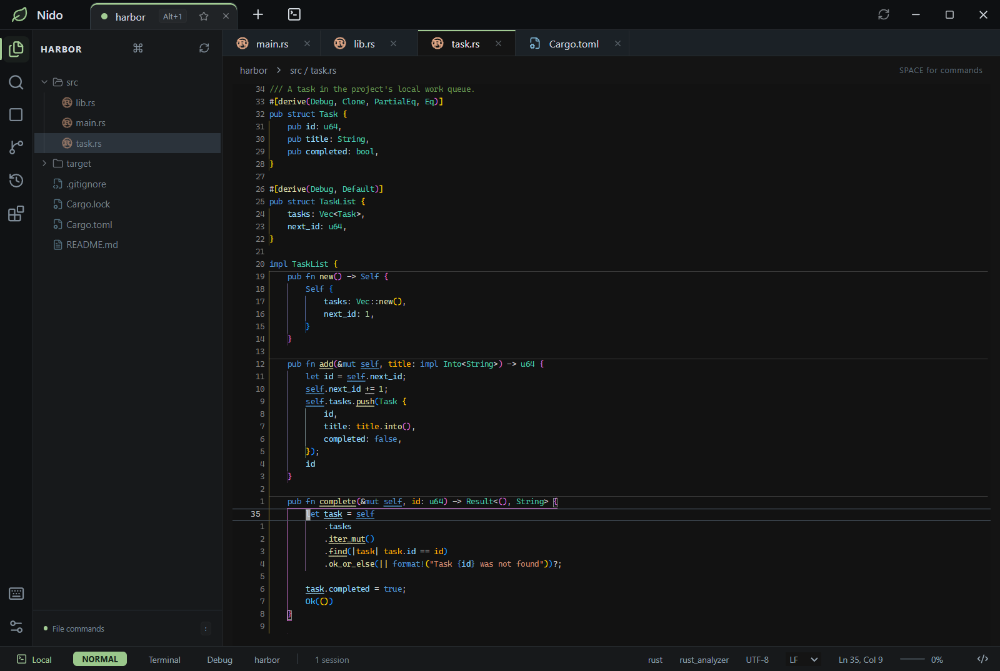

# Nido

[English](README.md) | [日本語](README.ja.md)

**A keyboard-first code editor powered by Neovim.**

Nido is an open-source desktop editor built with Electron, React, TypeScript, and Neovim. The goal is a comfortable, keyboard-driven development workflow: edit code, navigate files, search, work with Git, and use a terminal without constantly switching to the mouse.

**Nido is under active development, and contributors are welcome!** Whether you are interested in editors, Neovim, Electron, UI, testing, or documentation, we'd love to collaborate.



## Design philosophy

**Keep your hands on the keyboard.**

Nido builds on Vim-style editing and brings common development tasks into a single desktop application with a keyboard-focused interface.

## Current functionality

- Neovim-powered code editing.
- File navigation, search, Git tools, and an integrated terminal.
- Reorder file tabs by dragging or with `Ctrl+Shift+PageUp` / `PageDown`. Reopen closed files with `Ctrl+Shift+T`.
- Configurable Activity Bar placement: on the left edge or above the Explorer. Open Settings with `Space ,` to change it.
- Editing recovery: local history for named files and workspace restoration of modified unnamed buffers. Recovery has size limits and intervals; changes immediately before a crash may not be captured.

## Platform support

- **Windows x64** is the currently documented supported platform.
- macOS and Linux support should not be assumed from the presence of build scripts.

## Development quick start

On **Windows x64**, install Git, Node.js, and pnpm, then run:

```powershell
git clone https://github.com/kanata9819/Nido.git
cd Nido
pnpm install --frozen-lockfile
pnpm dev
```

The development command prepares bundled Neovim and debugger dependencies using PowerShell scripts. The first run may download external archives and requires network access.

To run checks:

```powershell
pnpm typecheck
pnpm lint
pnpm test
```

For contribution guidelines, troubleshooting expectations, and the code layout, see [CONTRIBUTING.md](CONTRIBUTING.md).

## Join the project

Nido is a community-friendly work in progress. Feedback, bug reports, documentation improvements, testing, and code contributions are welcome.

- [Explore or open issues](https://github.com/kanata9819/Nido/issues) to discuss bugs and ideas.
- Check [CONTRIBUTING.md](CONTRIBUTING.md) before opening a pull request.
- For substantial changes, please start with an issue so we can discuss the approach together.
- Japanese and English contributions are both welcome.

**Want to help build a keyboard-first editor? Join us!**

## License

Nido is licensed under the [MIT License](LICENCE). Third-party components may have separate license notices.
