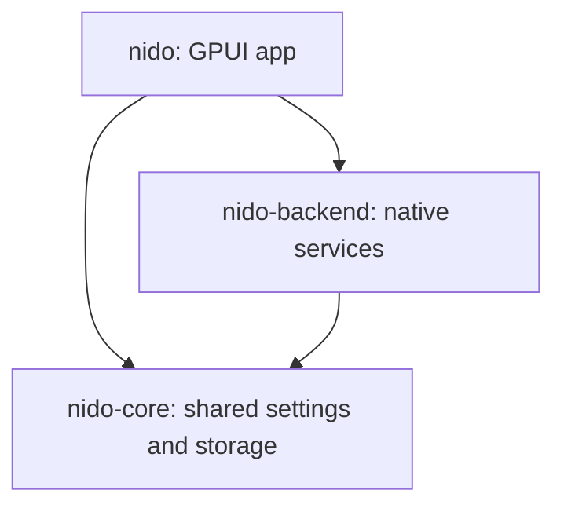

# Rustのソース構成

ルートの`Cargo.toml`は仮想workspaceです。バージョン、Rustの要件、依存の指定、
release profileをここで管理し、`crates/`の3クレートに実装を分けています。

| クレート | 責務 | 依存する内部クレート |
| --- | --- | --- |
| `nido-core` | 設定、永続化、ワークスペース内のパス検証 | なし |
| `nido-backend` | Neovim/RPC、ファイル操作、Git、Time Machine、拡張、WSL、更新 | `nido-core` |
| `nido` | 実行ファイル、GPUI、アプリの状態管理、描画、入力、統合検証 | `nido-core`、`nido-backend` |



GPUIは`nido`だけが使います。バックエンドはイベントとコールバックで結果を返すため、
Neovim連携やデータ保護のテストはGUIに依存せず実行できます。

## モジュールの探し方

| 場所 | 担当 |
| --- | --- |
| `nido-core/src/paths.rs` | パスの正規化、相対化、ワークスペース外や`.git`への変更の拒否 |
| `nido-core/src/persistence.rs` | 保存形式、検証、JSONの安全な書き込み |
| `nido-core/src/settings/` | 設定の読込・保存、旧Chromium設定の移行 |
| `nido-backend/src/session/` | セッション公開API、Neovimワーカー、読み取りワーカー、編集操作、シェル、ランタイム探索 |
| `nido-backend/src/files/` | 一覧・走査、検索・置換プレビュー、作成・移動・削除 |
| `nido-backend/src/packs/` | 拡張のマニフェスト検証、検出、インストール |
| `nido-backend/src/{git,history,rpc,updater,wsl}.rs` | 各外部機能との連携 |
| `nido/src/main.rs` | 起動モードの選択 |
| `nido/src/app/mod.rs` | アプリが保持する状態と、子モジュールの構成 |
| `nido/src/app/{lifecycle,workspaces,closing}.rs` | 初期化・保存、ワークスペース管理、未保存確認・終了 |
| `nido/src/app/{commands,input,palette,explorer}.rs` | 操作、入力の順序、候補選択、ファイル操作 |
| `nido/src/app/{events,integrations}.rs` | バックエンドからの結果反映、更新・WSLなどの操作 |
| `nido/src/app/ui/{window,layout,chrome,editor,explorer}.rs` | GPUI起動、画面配置、タイトルバー・タブ、エディター、ツリー |
| `nido/src/app/ui/{input,fields,controls,accessibility}.rs` | フォーカス、フォーム、ボタン、アクセシビリティ |
| `nido/src/app/ui/panels/` | 設定、Git、検索、Time Machine、デバッグ、参照、拡張の各パネル |
| `nido/src/app/ui/{overlays,documents}.rs` | ダイアログ・通知、Markdown・差分の表示 |
| `nido/src/app/ui/grid_view/` | 文字レイアウトのキャッシュ、セル描画、エディターIME |
| `nido/src/grid/` | Neovimの描画通知からのグリッド状態更新 |
| `nido/src/text_input/` | テキスト欄の選択操作、文字描画、UTF-16/IME処理 |
| `nido/src/smoke/` | RPCクライアント、編集・Git・ターミナル・LSP・デバッガーの統合検証 |
| `nido/src/app/checks.rs`、`app/ui/checks.rs` | アプリ状態と実GPUIウィンドウの統合検証 |

状態を定義する親モジュールの下に、操作・描画ごとの実装を置いています。
実装同士で必要なメソッドはその親の範囲に公開し、UI内部の型を他クレートに公開していません。

## 起動と検証

`default-members`は`nido`なので、ルートからの`cargo run --locked`で起動できます。
実行ファイル名と`target/`、`dist/`の配布先も従来どおりです。

```powershell
cargo run --locked
cargo fmt --all -- --check
cargo clippy --workspace --locked --all-targets -- -D warnings
cargo test --workspace --locked
cargo run --locked -- --smoke-test
cargo run --locked -- --ui-smoke-test
```

共通部分やバックエンドだけを検証する場合は、対象を指定できます。

```powershell
cargo test --locked -p nido-core
cargo test --locked -p nido-backend
```

CIは`--workspace`で全クレートを検査します。ランタイムは引き続きルートの`resources/`を
開発時に参照し、配布後は実行ファイル隣の`resources/`を使います。
インストーラーの作成と検証は`./scripts/package-windows.ps1`、`./scripts/test-package.ps1`です。
